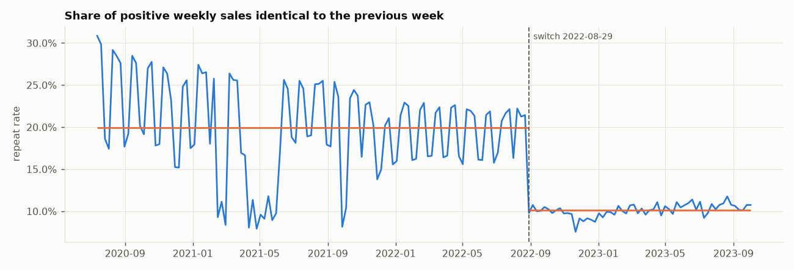
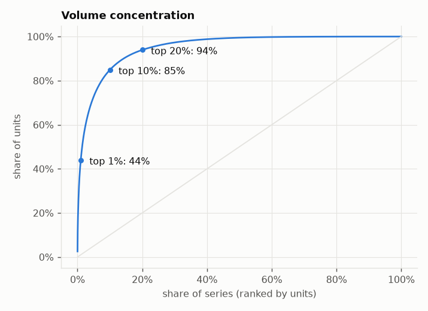
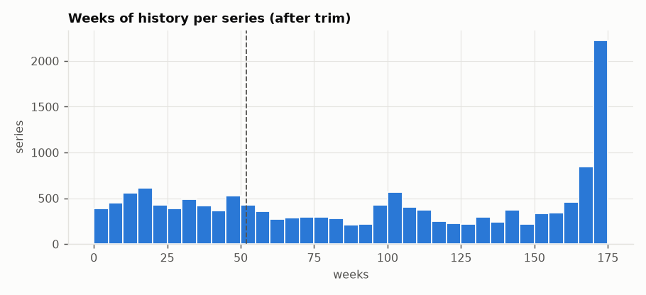
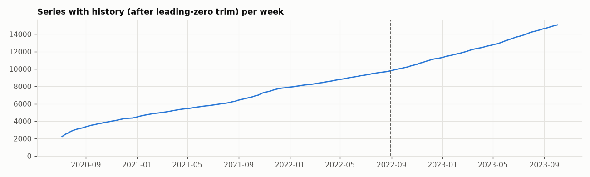
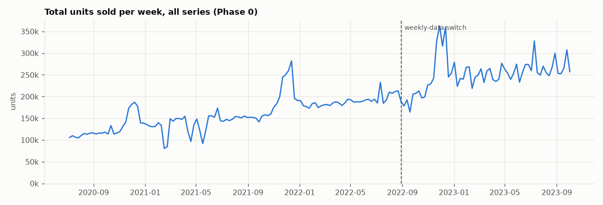
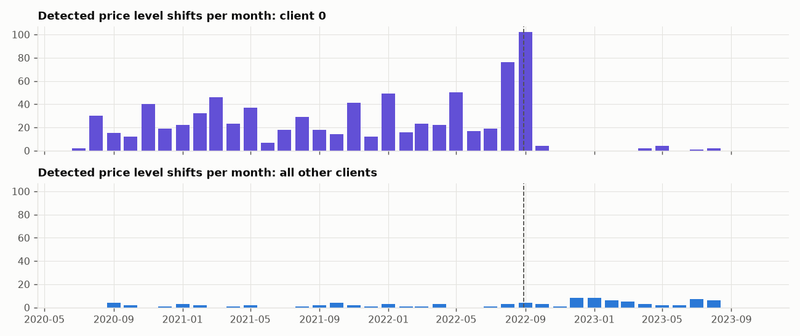
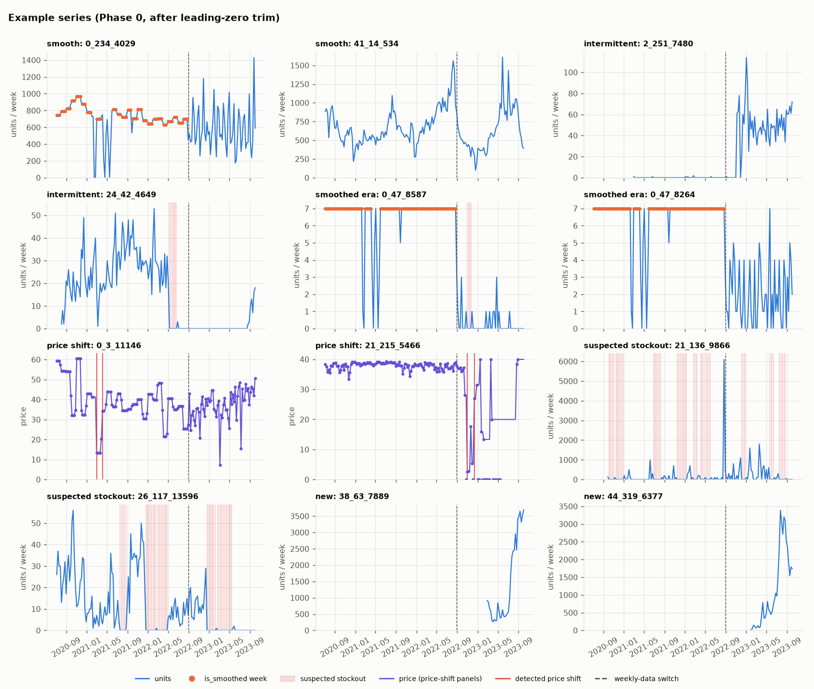

# Data quality report: VN1 (Phase 0 training data)

Generated by `python -m src.run_cleaning`. Training data: 2020-07-06 to 2023-10-02, 15,053 series, 170 weeks (2,559,010 raw rows, 1,419,748 after trimming leading zeros). Phase 1 and Phase 2 values are not used anywhere in this report.

## 1. Flags at a glance

Week percentages are out of 1,419,748 trimmed weeks; series percentages out of 15,053 series.

| flag | weeks | series with ≥1 | note |
|---|---|---|---|
| leading zeros trimmed | 1,139,262 (44.5%) of raw rows | 12,829 (85.2%) | median 93 weeks per affected series; 0 series never sold |
| `identical_run` | 78,566 (5.5%) | 5,507 (36.6%) | ≥3 identical positive weeks, any date |
| `is_smoothed` | 63,230 (4.5%) | 3,623 (24.1%) | identical run before 2022-08-29 |
| `is_smoothed_era` | 705,672 (49.7%) | 9,698 (64.4%) | any week before 2022-08-29 |
| `price_observed` | 722,573 (50.9%) | 15,053 (100.0%) | price recorded (only happens when y > 0) |
| `price_zero` | 4,755 (0.3%) | 1,537 (10.2%) | price = 0 while y > 0: treated as missing |
| `price_filled` | 697,754 (49.1%) | 13,494 (89.6%) | price_clean carried forward from an earlier week |
| `price_shift` | 881 (0.1%) | 367 (2.4%) | 896 shift events; 302 of 367 series are client 0 |
| `is_suspected_stockout` | 27,440 (1.9%) | 2,810 (18.7%) | 4,233 zero runs |
| `level_shift` | 5,638 (0.4%) | 3,667 (24.4%) | 4-week mean > 10x or < 1/10 of the previous 13 weeks |
| `group_level_shift` | 340 (0.0%) | 498 (3.3%) | 8 warehouse/client events: > 50% of a group's active series shift in the same week |
| `is_new` | - | 4,825 (32.1%) | < 52 weeks of history |
| `is_inactive` | - | 3,817 (25.4%) | no sales in last 13 weeks; 820 are also new |

Price missingness check: price is NaN in 1,836,437 weeks, all with zero sales; NaN with sales > 0: 0; price present with zero sales: 0. **The rule 'price is NaN exactly when sales are 0' holds exactly.** So price is a *transaction* price (revenue / units), not a list price: there is no price for weeks without sales.

`relative_price` (price ÷ median of past 13 weeks): median 1.000, 3.1% of weeks < 0.8, 2.2% > 1.25, 849 weeks > 5 (extreme price outliers left as they are).

Suspected-stockout weeks by the length of their zero run: 4-8 weeks 18,041 (65.7%), 9-13 weeks 9,399 (34.3%). Zero runs longer than 13 weeks are not flagged (`stockout.max_zero_run`): they look more like an off-season or dormancy than a stockout.

Group level-shift events (structural: a whole warehouse/client changes level at once):

| level | id | week | active series | shifted | share | direction |
|---|---|---|---|---|---|---|
| warehouse | 25 | 2020-10-26 | 5 | 3 | 60% | down |
| warehouse | 196 | 2022-03-07 | 14 | 8 | 57% | up |
| warehouse | 204 | 2022-08-29 | 5 | 3 | 60% | up |
| warehouse | 208 | 2022-10-24 | 11 | 6 | 55% | up |
| client | 2 | 2022-11-07 | 163 | 100 | 61% | up |
| warehouse | 251 | 2022-11-07 | 163 | 100 | 61% | up |
| warehouse | 116 | 2023-05-29 | 16 | 10 | 62% | up |
| warehouse | 324 | 2023-06-19 | 5 | 4 | 80% | down |

## 2. When does the data become truly weekly?

**Estimated switch date: 2022-08-29** (first week of genuine weekly data). Weeks before it: 705,672 (49.7%) of the trimmed training rows.

How it was found:

1. For each week, take all series with positive sales this week and last week, and compute the share whose value is *exactly* the same as last week (the *repeat rate*).
2. Genuine weekly counts repeat only by chance (mostly 1→1 on slow sellers). Monthly totals spread evenly over the weeks repeat by construction (7, 7, 7, 7).
3. A one-changepoint search (best split of the repeat-rate series into two constant levels, least squares) puts the break at 2022-08-29: repeat rate 20.0% before vs 10.1% after.
4. Cross-check: before the switch, weeks that start a new calendar month repeat the previous value 16.1% of the time vs 21.1% for mid-month weeks. After it the two are 10.4% and 10.0%. Values change when the month changes, which is the signature of monthly totals split across weeks.

Caveat: the repeat rate before the switch is ~2× the weekly floor, not 100%. Only part of each series is visibly smoothed (where runs are long enough), and after the switch `identical_run` still fires on 2.1% of weeks, which is the chance-repeat noise floor. Before the switch it fires on 9.0%. Also, 13 pre-switch weeks (mostly Feb-Jun 2021 and Oct 2021) already sit at the weekly floor, so the old era is a mix rather than uniformly smoothed. `is_smoothed` (run-level) is the more precise flag; `is_smoothed_era` is the blunt date cut.

## 3. Demand types (Syntetos-Boylan, ADI 1.32 / CV² 0.49)

| demand type | series (full history) | series (weekly era only) | share of units (full) |
|---|---|---|---|
| smooth | 2,909 (19.3%) | 3,268 (21.7%) | 62.5% |
| erratic | 2,006 (13.3%) | 1,719 (11.4%) | 27.2% |
| intermittent | 7,236 (48.1%) | 6,823 (45.3%) | 4.3% |
| lumpy | 2,902 (19.3%) | 1,873 (12.4%) | 5.9% |
| no_sales | 0 (0.0%) | 1,370 (9.1%) | 0.0% |

The smoothed era hides week-to-week variation (CV² looks smaller), so classifications on the full history lean smoother than on the weekly era alone. `no_sales` in the weekly-era column means the series had history but sold nothing after the switch.

## 4. Volume concentration

Top 1% of series (151) sell **43.9%** of units; top 10% sell **84.9%**; top 20% sell 93.9%. The VN1 score weights errors by volume, so the head drives it.

## 5. History length

Weeks of history after trimming: 10th pct 15, 25th 40, median 98, 75th 156, 90th 170 (max possible 170). 4,825 (32.1%) series have under 52 weeks.

## 6. Total weekly units

## 7. Price level shifts

367 series (2.4%) have ≥1 shift (896 events; 55% upward). 302 of them are client 0. 185 events fall in Aug-Sep 2022, the busiest two months. Many client-0 series flip up and down repeatedly (series with ≥3 shifts: 130); the flipping stops at the weekly switch. That points to a price-unit/aggregation artefact in the old era rather than real repricing.

Detection rule: trailing 8-week median vs the previous 8 weeks, ratio > 2.5 or < 1/2.5, each window needs ≥4 observed prices. With `min_periods=1` the count rises to 767 series (close to the ~758 seen in earlier EDA), but then a single odd price on a slow seller can trigger a 'shift'. `min_periods=4` is the default here. The trailing rule fires a median of 4 weeks after the located jump; `relative_price` resets at the detection week (causal), `price_shift` marks the back-dated jump week (descriptive only).

## 8. Example series

Two per category: smooth `0_234_4029`, smooth `41_14_534`, intermittent `2_251_7480`, intermittent `24_42_4649`, smoothed era `0_47_8587`, smoothed era `0_47_8264`, price shift `0_3_11146`, price shift `21_215_5466`, suspected stockout `21_136_9866`, suspected stockout `26_117_13596`, new `38_63_7889`, new `44_319_6377`.

## 9. Implications for modelling

- **Training window.** 50% of trimmed training weeks are before 2022-08-29 and look like monthly totals spread across weeks. That history is fine for level and yearly seasonality, but it hides weekly noise. Compare training on everything with down-weighting or dropping the smoothed era.
- **Start dates differ.** 85% of series had leading zeros (not yet listed) that were trimmed. 32% of series have under a year of history, so a yearly-seasonal model per series is not possible for them. Pooled/global models or hierarchy-level seasonality are needed.
- **Intermittency dominates.** 67% of series are intermittent or lumpy, but most units come from smooth/erratic series. Use Croston/TSB-style or zero-aware baselines for the tail, and judge the overall score on the head.
- **Inactive series.** 3,817 series sold nothing in the last 13 weeks. A zero or near-zero forecast is a strong baseline for them; check how many of them restart in Phase 1 before deciding.
- **Stockouts.** 2,810 series have suspected stockout weeks. Treating those zeros as true demand biases forecasts down. Options: mask them from the loss, or impute them for training only.
- **Price features.** Price only exists in weeks with sales, so `price_clean` is forward-filled and `relative_price` is safe to use as a past-only feature. Raw price levels are not comparable across a detected shift; use `relative_price` or `price_regime` instead.
- **Metric.** The VN1 score adds a bias term, so a systematic under-forecast (e.g. from stockout zeros) is penalised twice. Track `accuracy` and `bias` separately.
