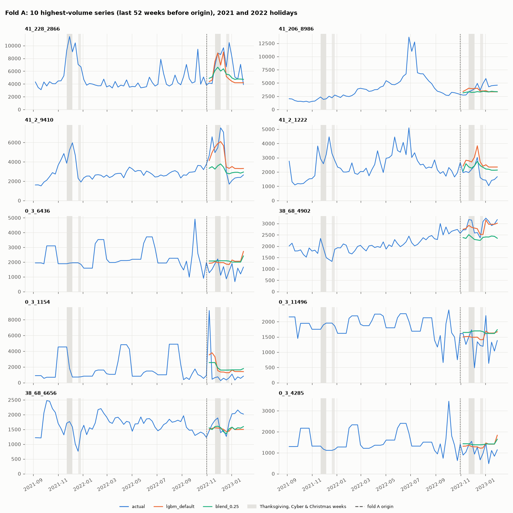

# Round 2: locked default, cap, fold A diagnosis, seasonality, blend

`python -m src.experiment_round2`. Phase 0 only (backtest folds A–D); Phase 1 and 2 untouched. Runtime 421 s.

**Locked default** (config `lgbm` / `features`): training origins `full` (from 2021-07-05), scale `max13_52`, no client/warehouse features, tweedie, default params, rows weighted by scale.

## Results: every configuration × fold

Cell = VN1 score (signed bias: + over-forecast, − under-forecast). Lower score is better. Fold A = holiday (origin 2022-10-31).

| config | A | B | C | D | average | avg signed bias |
|---|---|---|---|---|---|---|
| moving_avg_13 | 0.835 (-22.9%) | 0.765 (+12.9%) | 0.483 (-0.6%) | 0.500 (-2.8%) | 0.646 | -3.4% |
| seasonal_naive | 0.813 (-9.3%) | 0.726 (-2.7%) | 0.728 (-4.4%) | 0.774 (-7.4%) | 0.760 | -6.0% |
| blend_0.25 | 0.789 (-19.5%) | 0.701 (+9.0%) | 0.510 (-1.5%) | 0.528 (-4.0%) | 0.632 | -4.0% |
| lgbm_default | 0.644 (-8.4%) | 0.511 (-4.4%) | 0.447 (-0.8%) | 0.486 (-2.9%) | 0.522 | -4.1% |
| lgbm_default + cap k=1.5 | 0.644 (-8.6%) | 0.512 (-4.6%) | 0.447 (-0.9%) | 0.486 (-3.0%) | 0.522 | -4.3% |
| lgbm_default + cap k=2 | 0.644 (-8.5%) | 0.511 (-4.6%) | 0.447 (-0.9%) | 0.486 (-3.0%) | 0.522 | -4.2% |
| lgbm_default + cap k=3 | 0.644 (-8.5%) | 0.511 (-4.5%) | 0.447 (-0.8%) | 0.486 (-2.9%) | 0.522 | -4.2% |
| lgbm + uplift | 0.625 (-6.9%) | 0.515 (-5.8%) | 0.446 (-1.0%) | 0.476 (-1.9%) | 0.516 | -3.9% |
| lgbm + holiday_distance | 0.635 (-6.9%) | 0.519 (-5.2%) | 0.450 (-1.1%) | 0.486 (-3.0%) | 0.523 | -4.0% |
| 0.5 × lgbm + uplift + 0.5 × blend_0.25 | 0.692 (-13.2%) | 0.526 (+1.6%) | 0.466 (-1.3%) | 0.491 (-3.0%) | 0.544 | -4.0% |
| lgbm_weekly_only_mean13_ids (fold B only) | – | 2.338 (+96.3%) | – | – | – | – |
| lgbm_weekly_only_mean13_ids (fold B only) + cap k=2 | – | 1.053 (+32.0%) | – | – | – | – |
| lgbm_weekly_only_max13_52_ids (fold B only) | – | 3.222 (+140.1%) | – | – | – | – |
| lgbm_weekly_only_max13_52_ids (fold B only) + cap k=2 | – | 1.000 (+28.9%) | – | – | – | – |

- Cap adopted for the variants below the default: **no** (decided by the 4-fold average of the default with vs without cap k=2).
- Best LightGBM: **lgbm + uplift**. Best baseline: **blend_0.25** (from the backtest).

## 2. Fold B blow-ups (2.34 / 3.22)

Config `lgbm_weekly_only_max13_52_ids` on fold B: total forecast 7,814,821 units vs actual 3,255,126 (2.4×). The top 10 series make 18% of the absolute error; **warehouse 251 makes 68%**.

Cause: on **2022-11-07 warehouse 251 (client 2) jumped ~533× overnight** (median after/before ratio over 101 series that sold on both sides; 98% jumped > 20×; 65 new series started there that week). The `weekly_only` training origins for fold B (2022-09-05 → 2022-10-31) have pre-jump scales (~1 unit/week) and post-jump targets (hundreds/week), so scaled targets of several hundred, all in warehouse 251. With `warehouse` as a feature the model learns "warehouse 251 → ×hundreds" and applies it at the fold B origin, where the scale is already post-jump: the multiplier is applied twice. Without client/warehouse it can't isolate the warehouse; with full history the 5 contaminated origins are diluted by 30 clean ones.

| unique_id | warehouse | first_sale | mean_before_2022_11_07 | mean_13wk_before_origin | max_52wk_before_origin | forecast_per_week | forecast_per_week_without_ids | actual_per_week | error_share |
|---|---|---|---|---|---|---|---|---|---|
| 2_251_2723 | 251 | 2021-07-12 | 0.9 | 1,018 | 2,407 | 18,663 | 564 | 571 | 4.0% |
| 2_251_9222 | 251 | 2022-01-10 | 3.5 | 989 | 1,452 | 17,907 | 818 | 772 | 3.8% |
| 2_251_9112 | 251 | 2021-04-26 | 0.4 | 395 | 520 | 8,057 | 282 | 330 | 1.7% |
| 2_251_1871 | 251 | 2021-05-17 | 0.4 | 416 | 1,021 | 7,861 | 214 | 212 | 1.7% |
| 2_251_13072 | 251 | 2022-06-27 | 0.4 | 307 | 523 | 7,091 | 360 | 347 | 1.5% |
| 32_217_2605 | 217 | 2021-02-22 | 1.5 | 626 | 1,337 | 7,673 | 638 | 1,411 | 1.4% |
| 2_251_5934 | 251 | 2021-10-25 | 0.1 | 291 | 883 | 5,260 | 84 | 60 | 1.1% |
| 32_193_7056 | 193 | 2021-12-13 | 63.5 | 708 | 1,769 | 5,520 | 359 | 519 | 1.1% |
| 2_251_2528 | 251 | 2021-08-02 | 0.0 | 226 | 433 | 5,079 | 159 | 99 | 1.1% |
| 2_251_2594 | 251 | 2021-12-06 | 0.2 | 245 | 471 | 4,812 | 203 | 85 | 1.0% |

Not caught by cleaning: the price-shift detector looks at price, and nothing looks for a level shift in *sales* across a whole warehouse. Worth adding (flag + per-series regime, like `price_regime`).

## 3. Forecast cap

forecast ≤ k × the series' max weekly sales in the 52 weeks up to the origin (0 if it sold nothing then). Averages over the four folds for the default model:

| k | forecasts_capped | series_capped | units_removed |
|---|---|---|---|
| 1.5000 | 9.79% | 1,296 | 0.18% |
| 2.0000 | 9.39% | 1,223 | 0.13% |
| 3.0000 | 9.18% | 1,185 | 0.09% |

Scores are in the main table. The cap also fixes the fold B blow-ups (rows marked *fold B only*).

## 4. Fold A (holiday) diagnosis

LightGBM = `lgbm_default`; baseline = `blend_0.25`.

### Signed bias by period

| period | units | lgbm signed bias | baseline signed bias |
|---|---|---|---|
| before peak (2022-11-07 → 2022-11-14) | 470,994 | +3.1% | -7.0% |
| peak (Thanksgiving → pre-Christmas) (2022-11-21 → 2022-12-12) | 1,366,972 | -10.9% | -31.3% |
| Christmas → New Year (2022-12-19 → 2023-01-02) | 778,255 | -8.0% | -16.0% |
| January (2023-01-09 → 2023-01-30) | 972,885 | -10.6% | -12.0% |

### By volume band

| volume band | units | lgbm score | baseline score | lgbm signed bias | baseline signed bias | lgbm error share |
|---|---|---|---|---|---|---|
| top 1% | 29.9% | 0.344 | 0.463 | -0.4% | -8.0% | 18.2% |
| top 1-10% | 37.5% | 0.558 | 0.633 | +3.0% | -7.0% | 35.3% |
| rest 90% | 29.2% | 0.983 | 1.184 | -20.7% | -38.2% | 40.5% |
| first sale after origin | 3.4% | 2.000 | 2.000 | -100.0% | -100.0% | 6.0% |

### By demand type at origin

| demand type | units | lgbm score | baseline score | lgbm signed bias | baseline signed bias | lgbm error share |
|---|---|---|---|---|---|---|
| erratic | 16.4% | 0.737 | 0.961 | -1.9% | -18.4% | 21.0% |
| first sale after origin | 3.4% | 2.000 | 2.000 | -100.0% | -100.0% | 6.0% |
| intermittent | 8.4% | 1.524 | 1.605 | -48.9% | -53.7% | 15.5% |
| lumpy | 5.9% | 1.023 | 1.353 | -14.7% | -39.6% | 9.2% |
| no_sales | 0.1% | 1.943 | 2.000 | -53.2% | -100.0% | 0.1% |
| smooth | 65.9% | 0.413 | 0.529 | +0.5% | -9.5% | 48.1% |

### Top 10 series (10% of fold A units)

Peak-period signed bias for these 10: LightGBM +5.2%, baseline -12.8%.

## 5. Seasonality improvements

- `uplift`: `ly_uplift_series`, `ly_uplift_client` = last year's target weeks ÷ last year's level at the same point (series and client totals). Gives the model last year's *shape* without last year's *level*.
- `holiday_distance`: `tw_weeks_to_thanksgiving`, `tw_weeks_to_christmas` (signed weeks, ±13).

Gain share of the new features in the best LightGBM (mean over folds): `ly_uplift_series` 6.3%, `ly_uplift_client` 6.2%.

## 6. Blend

`0.5 × lgbm + uplift + 0.5 × blend_0.25`: see the main table.
